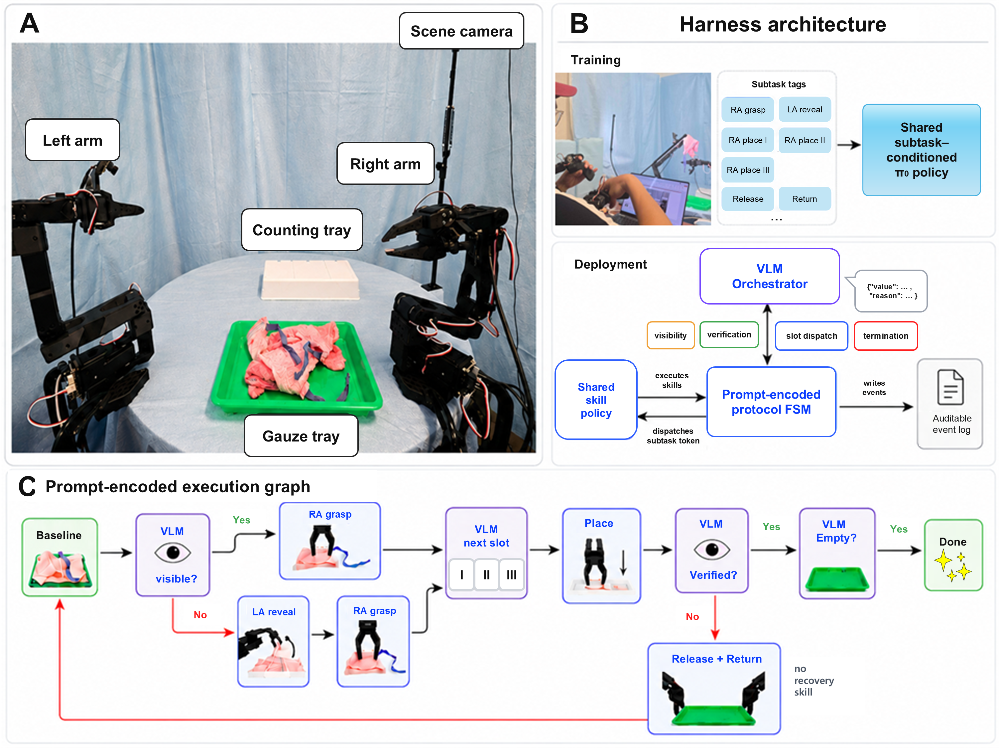

# SurgeCount

**A Protocol-Guided Composition Harness for Bimanual Surgical Sponge Counting**

Research code for ML4H 2026.

**Sungeun Kim, Xiaoman Zhang, Xucheng Wang, Pranav Rajpurkar**

SurgeCount uses two SO-101 arms to move individual surgical sponges from a
source tray into ordered counting slots. A single language-conditioned policy
learns eleven skills and a stopping signal alongside twelve robot actions.
An operator or a stateful vision-language planner chooses the next skill at
each boundary.

[Demonstrations](#demonstrations) · [System overview](#system-overview) ·
[Results](#results) · [Installation](#installation) · [Quick start](#quick-start)

**Datasets and checkpoints will be released upon publication.**

## Demonstrations

Two complete procedures: SurgeCount counts three gauzes into the ordered
tray, grasps each by its blue radiopaque thread, verifies placements, and
recovers from failed grasps. Play the videos directly below.
All eight original clips are also available in the [MP4 folder](website/static/videos/).

### Full procedure 1

https://github.com/user-attachments/assets/b9a7de95-ba37-46f3-bf13-eddd0e51d600

### Full procedure 2

https://github.com/user-attachments/assets/4c6ca2b3-2bc2-4d38-8cc3-c59e398dc8f8

## System overview



1. **Learned stop boundaries.** The policy predicts twelve robot actions and
   a stop signal, keeping the selected skill active until its stopping boundary.
2. **Stateful orchestration.** At each boundary, a frozen Gemini VLM selects
   the next skill under a prompt-encoded protocol with visual verification gates.
3. **Composed recovery.** Failed grasps trigger learned release-and-return
   skills before the orchestrator selects the next attempt.

## Results

Across **100 real-robot trials**—five methods evaluated on the same 20 layouts—
SurgeCount fills **47 of 60 slots** and completes **12 of 20 procedures**.

| Method | Slots filled / 60 | Complete procedures / 20 |
| --- | ---: | ---: |
| ACT | 7 | 0 |
| SmolVLA | 12 | 0 |
| π₀ | 27 | 3 |
| π₀.₅ (end-to-end) | 15 | 2 |
| **SurgeCount** | **47** | **12** |

Compared with the strongest baseline, π₀, the slot-fill difference is
significant by a Wilcoxon signed-rank test (*p* < 0.01), and the procedure
completion difference by McNemar's exact test (*p* < 0.05).

## Grasp strategies

### Visible thread

The right arm grasps the blue thread, places the gauze into the next slot,
releases it, and returns to rest.

https://github.com/user-attachments/assets/0ce8313a-d1e7-41d6-9a67-e2e36433a5f5

### Occluded thread

The left arm lifts a neighboring gauze to expose the blue thread. The right
arm then grasps the exposed thread and places the gauze into the counting tray.

https://github.com/user-attachments/assets/e914b74e-81a2-4f69-a3b5-4160686d0074

## Failure and recovery

### Recovery 1: grasping the gauze body

The orchestrator detects a grasp on the white gauze body, releases the gauze,
and retries the required blue-thread grasp.

https://github.com/user-attachments/assets/65a21152-db8e-48ad-853b-d72a0c97b7c6

### Recovery 2: the thread remains hidden

After the right-arm grasp, the orchestrator sees that the blue thread remains
hidden. The arm releases the gauze and retries thread exposure.

https://github.com/user-attachments/assets/aaf2ae76-1c7b-457f-9624-ae0af8925cd7

### Recovery 3: switching strategies

An exposed-thread grasp fails during the occluded-thread strategy. Releasing
the gauze leaves its blue thread visible, and the orchestrator switches to
the visible-thread strategy, which succeeds in this trial.

https://github.com/user-attachments/assets/ac7c6868-0d74-452a-a7a0-4aa8aaf3b987

### End-to-end baseline: missed grasp

After the left-arm reveal, the end-to-end π₀.₅ baseline misses the exposed
thread and the procedure stalls.

https://github.com/user-attachments/assets/dd56678a-9e3a-4071-a1fc-c00b21ec7c90

## Code overview

The end-to-end pi0.5 baseline is implemented from pi0 with a trained subtask
predictor, following the original pi0.5 paper (arXiv:2504.16054). At each action
chunk boundary, the overhead image and an umbrella instruction produce subtask
text that conditions twelve-dimensional action generation. SurgeCount uses
thirteen-dimensional outputs and the separate operator/Gemini composition
harness. See [models](docs/models.md) for the two interfaces.

This repository contains the data collection, data preparation, training,
manual deployment, and Gemini composition code, plus the figures and
demonstration videos shown above. It includes the patched LeRobot source
needed by the runtime.

The local examples support independently collected data and compatible
checkpoints.

## Installation

Use **Python 3.12**, FFmpeg (including `ffprobe`), and `uv`. Run commands from
this repository root. The dependency lock pins `transformers==5.3.0` and uses
the included LeRobot snapshot.

```bash
# Data preparation, offline checks, and tests
uv sync --frozen --no-editable --python 3.12 --extra data --extra dev

# Training and physical robot deployment; planner is optional
uv sync --frozen --no-editable --python 3.12 --extra data --extra dev --extra train --extra robot --extra planner
```

The full environment installs PyTorch and model dependencies.
Training uses an NVIDIA GPU; the experiment used an H200. The
deployment example targets CUDA. See [validation](docs/validation.md) for
backend coverage. Provide platform-appropriate FFmpeg and device
drivers before using video or hardware commands. Activate the environment
with `source .venv/bin/activate` to use the bare command names in the guides.
These release installs use ordinary packages. After changing source, repeat
the sync command with `--reinstall-package surgecount` (and
`--reinstall-package lerobot` for vendor changes).

## Quick start

Use `--help` for command options. These dry runs validate and print
configuration offline:

```bash
uv run --no-sync surgecount-record --config configs/record.json --hardware configs/robot.example.json --dry-run
uv run --no-sync surgecount-train --config configs/train.json --dry-run
uv run --no-sync surgecount-deploy --config configs/deploy.json --hardware configs/robot.example.json --dry-run
```

1. **Collect demonstrations.** Copy `configs/robot.example.json` to an ignored
   `configs/robot.local.json`, fill in the actual ports/cameras and existing
   verified calibration/home files, then run the recording command with
   `--check`. Remove `--check` to collect leader-follower teleoperation.
   Digit keys label skills; `2` then `a/b/c` selects a slot. See
   [hardware and recording](docs/hardware.md).
2. **Prepare a new dataset copy.** Inspect your LeRobot v3 data with
   `surgecount-data inspect`. Write a separate dataset with a thirteenth
   action target using `surgecount-data add-stop`. See
   [data format, cleaning, and stop labels](docs/data.md).
3. **Train.** Point `configs/train.json` at a locally prepared dataset and
   supply a compatible local initialization checkpoint with `--base-model`.
   Inspect the dry-run report, then launch with `surgecount-train`. See
   [training](docs/training.md) for episode filtering, normalization, and
   checkpoint initialization.
4. **Deploy.** Provision a local checkpoint and tokenizer cache, complete the
   hardware configuration, and run `surgecount-deploy --check` before the
   real command. Manual skill selection is the default. For the automated
   harness, add `--mode gemini` and export `GEMINI_API_KEY`. See
   [deployment](docs/deployment.md) for stop rules, timeouts, camera names,
   arm holding, and operator controls.

Recording and deployment commands operate real motors. `--dry-run` and
`--check` run offline; robot connections use existing calibration.

## Final training recipe

| Item | Setting |
| --- | --- |
| Dataset | Curated bimanual gauze demonstrations; release upon publication |
| Release initialization | Explicit compatible checkpoint; full finetuning |
| Episode subset | After 250; release default is `episode_index >= 251` |
| Sampling | Exclude idle task 0 and drop task 8 as training anchors |
| Observations | Twelve joint/gripper states; three recorded RGB views |
| Policy images | One camera per skill; other two images blacked out |
| Targets | Twelve robot actions plus stop; final ten segment frames have stop=1 |
| Batch / precision | 192 / bfloat16, gradient checkpointing |
| Checkpoint interval | Every 1,000 steps |

The release defaults are 10,000 steps and the vendored optimizer preset.
The trainer uses the `pi05` checkpoint interface and requires an explicit
initialization checkpoint through `--base-model`.
Idle/drop filtering applies to sampled anchor frames; native temporal action
chunks may extend across task boundaries. New release-trained checkpoints
retain native camera names; the historical deployment preset expects OpenPI
names. The deployment
checker requires the selected names to match the checkpoint.

See [models](docs/models.md) for local checkpoint requirements and
[data lineage](docs/data.md) for the recording collection, curated dataset,
and eligible training subset.

## Repository map

```text
src/surgecount/        Collection/deployment launchers, dataset tools, training hooks
configs/              Portable recording, training, deployment, and hardware examples
vendor/lerobot/        Patched LeRobot source, upstream license, change record
tests/                Offline data, filtering, runtime, and website regressions
docs/                 Setup, data lineage, models, provenance, and validation
website/              Architecture figure, demo videos, and optional offline HTML page
tools/                Source release and website checks
```

## Checks

```bash
uv run --no-sync pytest
uv run --no-sync ruff check src tests tools
uv run --no-sync python tools/check_release.py
uv run --no-sync python tools/check_website.py --public --media
```

CI tests data preparation, filtering, runtime controls, and release artifacts
offline. See [validation](docs/validation.md) for test coverage and hardware
validation requirements.

## Media and licensing

This README is the project page. The architecture figure and eight full
demonstration videos are included in the repository, and the videos play
inline on GitHub. See [media notes](docs/website.md) for the source files and
optional offline HTML page, and [release privacy notes](docs/anonymity.md)
for source packaging.

First-party code and the LeRobot snapshot use Apache-2.0. The website layout
and third-party assets have separate terms in [THIRD_PARTY.md](THIRD_PARTY.md).
Use `CITATION.cff` for the software citation.
